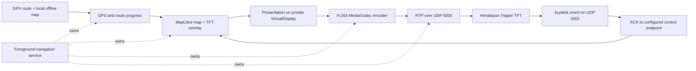

# MirrorDash off-screen navigation design

**Status:** Approved by owner; implementation in progress, 2026-11-07  
**Date:** 2026-11-07  
**Workspace:** `/home/optimus_prime/Projects/re-maps-screen-mirroring`  
**Decision owner:** Dharmil Virani  

The owner approved the consolidated design for planning on 2026-11-07. It
includes app-owned map rendering with H.264/RTP, GPX plus offline map data, the
screen-off foreground session, and the one-screen phone workflow. This is not
an implementation plan and no application code has been changed for this
design.

## Owner amendment — 2026-11-08

For the current iteration, preserve **Connect & mirror** and fit the selected
Maps screen into a semicircular TFT viewport. Keep the map app's own displayed
ETA and distance as part of the mirrored pixels; do not extract or recreate
those values. App-owned MapLibre/GPX work is deferred. After the owner reconnects
the phone, inspect the Royal Enfield app with REA to understand its locked-phone
connection behavior. The next session goal is to keep the Tripper connection
alive while locked, allow video to pause, resume mirroring after unlock, and
stop only on an explicit disconnect. This amendment supersedes the earlier
app-owned-map direction for the immediate implementation sequence.

## Problem and outcome

The current MirrorDash MVP captures a selected app window with Android
MediaProjection and streams H.264/RTP to the Tripper. The desired app must
instead draw its own live navigation map so the phone display can be turned off
and the session can remain active while the app is in the background.

The user needs a route map similar in information structure to the supplied
reference image: map and highlighted route, rider position/direction, remaining
distance, and estimated arrival time. The TFT should receive it while the
phone's physical display is off. The user also needs joystick zoom control,
editable Tripper connection settings, and an offline path for a route saved on
the phone.

## Agreed MVP scope

- Render a MirrorDash-owned map and navigation overlay; do not capture Google
  Maps or another app window.
- Import GPX routes and keep route geometry on the phone.
- Download a route-area offline map pack before the ride. A complete local route
  and map pack must be usable without mobile data.
- Show current location, route line/progress, remaining distance, and a
  speed-based ETA estimate. No live traffic or offline rerouting is promised.
- Keep the existing Tripper H.264/RTP video transport and K1G control path.
- Receive and acknowledge joystick events. Map directional controls to zoom;
  use the select/click control to recenter only after the event is confirmed on
  the owner's bike.
- Keep the connection profile editable, including SSID, optional passphrase,
  TFT IP, control transmit/receive UDP ports, video UDP port, output dimensions,
  frame rate, and bitrate.
- Keep a user-started foreground session active when the app is backgrounded
  and the phone display is off. The phone may be locked after start, subject to
  target-device validation.
- Keep a persistent notification with session status and a Stop action.
- Keep GPX routes and live location local. Do not add an account, backend,
  analytics, or location upload.

## Out of scope for the MVP

- Reusing Google Maps' private downloaded map cache or private saved-route
  storage.
- Live traffic, reliable online turn-by-turn routing, voice guidance, or
  automatic rerouting. These may be evaluated later as a separate feature.
- Sending vector tiles, map commands, or route geometry directly to the TFT.
  No reviewed source demonstrates a Tripper-side vector-map receiver.
- Royal Enfield firmware changes or claims of official Royal Enfield support.
- Automatic phone-panel power commands through Shizuku. The user can use the
  phone's normal power button; the app-owned render path does not use
  MediaProjection.

## Product and interface contract

### Phone workflow

Keep one compact **Ride** screen, consistent with the existing
[MirrorDash design system](../design-system/mirrordash.md):

1. Select a saved GPX route or import one through Android's file picker.
2. Confirm that the route's offline map pack is complete; download or resume it
   while internet access is available.
3. Expand the bike profile and edit connection or video settings as needed.
4. Start from the visible app. Complete location, nearby-Wi-Fi, notification,
   and Android Wi-Fi association prompts.
5. Confirm GPS, TFT connection, authentication, and active stream state.
6. Turn off or lock the phone display. Use the TFT joystick during the ride and
   Stop from the ongoing notification when finished.

Persist non-secret bike profile values. Keep the optional Wi-Fi passphrase in
memory only and never write it to logs. Use clear states for missing route or
map data, GPS not ready or stale, Wi-Fi association, authentication failure,
active stream, reconnecting, error, and stopped.

### TFT view

Use the supplied screenshot as a reference for hierarchy, not as an asset or
Google Maps clone. The map should dominate the round display; the route and
rider marker should remain visually distinct; remaining distance and ETA should
sit in a compact lower information area. Use an original, high-contrast map
style with a small label set. Draw vector details at the selected encoder size
to retain crisp lines and type.

The exact circle mask, safe area, and crop are not known from an official panel
specification. Match and review the frame on the actual TFT before fixing the
layout. A GPX track normally provides route geometry, not guaranteed
turn-by-turn instructions. Show route progress and ETA for every supported
route; show a maneuver only when the imported file provides a usable cue.

## Proposed architecture

### Renderer and transport

Use a MapLibre `MapView` in an Android `Presentation` attached to a private
`VirtualDisplay`; provide the existing H.264 encoder input surface as that
display's output. This draws MirrorDash's own view into a surface and does not
mirror the phone's physical display. Android documents that virtual-display
content is rendered to an app-provided `Surface`, that the `PRESENTATION` flag
registers a presentation display, and that non-public displays do not
automatically mirror the default display. [DisplayManager API](https://developer.android.com/reference/android/hardware/display/DisplayManager),
[Presentation API](https://developer.android.com/reference/android/app/Presentation)

This is the preferred implementation pattern because the map can remain a
live view while GPS or joystick input changes the camera. A similar renderer is
already present in the separate prior project at
[TripperMapRenderer.kt](/home/optimus_prime/Projects/re-connector/app/src/main/java/com/dharmil/reconnector/dash/render/TripperMapRenderer.kt:45).
That source is a design reference only; its presence does not prove that
screen-off rendering or TFT compatibility works on the owner's hardware. Keep
this implementation in the current workspace. The service must own the
renderer without retaining an Activity, run Presentation/MapView lifecycle
operations on the main thread, and dismiss/release the Presentation and
VirtualDisplay before releasing the encoder's input Surface. MapLibre
`MapSnapshotter` is a fallback if the Presentation/VirtualDisplay path is
unreliable; its API is called on the main thread and renders the snapshot off
the UI thread.
[MapSnapshotter API](https://maplibre.org/maplibre-native/android/api/-map-libre%20-native%20-android/org.maplibre.android.snapshotter/-map-snapshotter/index.html)

Continue using the existing hardware H.264 encoder and RTP packetizer, sending
to the configured Tripper video endpoint (default UDP 5000). No reviewed
protocol source shows a native vector or tile transport accepted by the TFT.
Community implementations render frames at 526×300 and send H.264/RTP;
therefore that remains the default stream size, not a claimed official TFT
maximum. [OpenDash encoder](https://github.com/jayvadolkar/open-dash-re/blob/ed26faf78449a42eb9fc5934957e3e8feaa9839a/app/src/main/java/com/example/opendash/dash/video/DashEncoder.kt),
[OpenDash transport overview](https://github.com/jayvadolkar/open-dash-re/blob/ed26faf78449a42eb9fc5934957e3e8feaa9839a/README.md)

Keep 526×300, 4 fps, and 204,800 bit/s as the conservative default carried by
the current profile. Leave higher dimensions available only as explicitly
experimental options. The current app's 1280×720 validation ceiling is not
evidence that the TFT can decode that size. Mark a mode supported only after a
parked test confirms stable TFT display, correct crop, and readable text.

### GPX and offline map data

The MVP route source is a GPX file imported into MirrorDash. Store the route
locally. The user may plan a route in another app and export/share GPX, but
this research identified no supported public API for importing Google Maps'
private saved-route or offline-map cache.

Use MapLibre Native Android for rendering and offline-region support, with an
OSM-derived vector style/provider. OpenFreeMap is the proposed initial tile
source because its published terms allow limited offline downloads without an
API key. Its current terms cap each download at 3,000 tiles or 50 MB and at
four parallel requests, and require a unique User-Agent that identifies the
app. Service availability is best-effort with no SLA. The
download flow must enforce the provider's published limits and disclose that
map-pack availability depends on the chosen provider. Do not bypass provider
limits. [OpenFreeMap terms](https://openfreemap.org/tos/),
[MapLibre offline-region API](https://maplibre.org/maplibre-native/android/api/-map-libre%20-native%20-android/org.maplibre.android.offline/index.html)

Download and validate route/map data before associating to a local-only Tripper
Wi-Fi network. During navigation, the renderer reads the saved route and
completed offline pack. If GPS deviates from the route while offline, show an
off-route state; do not invent a reroute. Estimate arrival from remaining route
distance and recent speed; label it as an estimate. The app does not receive
live traffic. Show required map attribution within the TFT layout.

### Background session and lifecycle

The foreground service owns the active route, location updates, renderer,
encoder, Tripper network, joystick receiver, and session status. Start it from
the visible Ride screen after the user grants required permissions. Declare
location and connected-device foreground-service types and their current
Android permissions. Android documents that foreground location can continue
when the app is backgrounded or the display is off; location permissions must
be granted before starting a location foreground service. [Location permissions](https://developer.android.com/develop/sensors-and-location/location/permissions),
[Foreground-service type requirements](https://developer.android.com/about/versions/14/changes/fgs-types-required)

Hold a partial CPU wake lock and Wi-Fi lock only while an active stream needs
them, then release them on Stop, service failure, or fatal protocol error.
Android Doze can ignore wake locks and suspend network access, so locks do not
prove an uninterrupted session. Use bounded reconnect attempts and show status
in the ongoing notification. [Doze behavior](https://developer.android.com/training/monitoring-device-state/doze-standby),
[Wi-Fi lock API](https://developer.android.com/reference/android/net/wifi/WifiManager.WifiLock)

The session must start while the app is visible. After start, the user can use
the normal power button to turn off and lock the phone; no MediaProjection
picker, Shizuku permission, or unlocked-screen requirement is part of this
design. Screen-off and lock persistence on the owner's Android 16/iQOO device
remain validation gates.

### Joystick and Tripper configuration

Keep all connection settings editable. Use the owner-reported profile as
editable defaults only:

| Setting | Default |
|---|---:|
| Wi-Fi SSID | `RE_LT09_260125` |
| TFT IPv4 | `192.168.1.1` |
| Control transmit UDP port | `2000` |
| Control receive UDP port | `2002` |
| Video UDP port | `5000` |
| Output | `526×300`, `4 fps`, `204800 bit/s` |

These are user observations, not manufacturer specifications. Existing
community implementations describe inbound button TLVs on the response socket
and an ACK packet. OpenDash assigns `0x14` to zoom in and `0x13` to zoom out;
another implementation assigns those events to left/right UI navigation.
Treat button-to-action mapping as app behavior, make zoom direction reversible,
and confirm codes/ACKs on the target bike before relying on them.
[OpenDash button handling](https://github.com/jayvadolkar/open-dash-re/blob/ed26faf78449a42eb9fc5934957e3e8feaa9839a/app/src/main/java/com/example/opendash/dash/DashSession.kt),
[OpenDash zoom mapping](https://github.com/jayvadolkar/open-dash-re/blob/ed26faf78449a42eb9fc5934957e3e8feaa9839a/app/src/main/java/com/example/opendash/viewmodel/DashViewModel.kt),
[Better Dash control handling](https://github.com/OpenMotoDash/better-dash/blob/e32d885372e8f18b49c3bf73c8add8692d377b5/dash_ui/bike_link.py)

## Security, privacy, and safety

- The active stream contains map/location imagery and goes to the TFT over the
  selected Tripper Wi-Fi. Current protocol evidence indicates application-level
  video is not encrypted and the peer identity is not cryptographically pinned.
  The user must connect only to a trusted bike network. This residual risk is
  recorded in the existing [security review](../reviews/security-review.md).
- GPX route and live GPS state stay on-device. Do not log coordinates, GPX
  points, passphrases, key material, encoded frames, or complete protocol
  packets. No cloud or analytics endpoint is in scope.
- Offline map downloads reveal the requested map region to the tile provider.
  The app should disclose the provider and requested area before download.
- Keep touch interaction to pre-ride setup. The active riding view is for
  glanceable display; operational controls while riding use the TFT joystick.
- All acceptance testing against the motorcycle is performed while parked.

## Requirements and validation trace

| ID | Requirement | Acceptance evidence |
|---|---|---|
| REQ-MD-01 | Render the app-owned route map and lower distance/ETA panel. | `TST-MD-01`: actual TFT shows correctly framed map, route, rider marker, distance and ETA. |
| REQ-MD-02 | Send H.264/RTP through the configured Tripper endpoint. | `TST-MD-02`: TFT decodes continuous frames at the default profile. |
| REQ-MD-03 | Follow an imported GPX route with a saved offline map. | `TST-MD-03`: complete a parked route preview with internet disabled after map preparation. |
| REQ-MD-04 | Continue the active session when the app is backgrounded and the phone display is off. | `TST-MD-04`: run a parked 10-minute session with screen off; separately observe lock behavior. |
| REQ-MD-05 | Use joystick input for zoom and recenter, with event acknowledgment. | `TST-MD-05`: verify raw button action, ACK, zoom direction, recenter, and behavior after reversing the direction setting. |
| REQ-MD-06 | Allow users to edit all Tripper network/video values. | `TST-MD-06`: save/reopen non-secret profile values; confirm passphrase is not persisted or logged. |
| REQ-MD-07 | Stop cleanly and recover from network loss. | `TST-MD-07`: notification Stop and Wi-Fi loss release/restore owned resources; reconnect is bounded and visible. |
| REQ-MD-08 | Keep trip data local and expose map-provider disclosure/attribution. | `TST-MD-08`: inspect network flows/logs and the rendered map attribution. |
| REQ-MD-09 | Keep output dimensions configurable without claiming unsupported modes. | `TST-MD-09`: sweep dimensions while parked; label only observed TFT-compatible modes as supported. |

All `TST-MD-*` items are planned validation, not completed tests. Do not claim
FOTA 11.63, screen-lock, joystick, offline-map, or resolution compatibility
until observed with the owner's actual phone and TFT. If making a battery or
thermal improvement claim, measure it on the target phone; display-off alone
does not establish total energy savings.

## Decisions

| ID | Decision | Reason | Status |
|---|---|---|---|
| DEC-MD-01 | Use app-owned map rendering, not MediaProjection of Google Maps. | Removes dependence on the captured app window while preserving the desired navigation information. | Approved by owner, 2026-11-07 |
| DEC-MD-02 | Keep H.264/RTP to the TFT. | This is the only output path demonstrated by reviewed Tripper implementations. | Approved by owner, 2026-11-07 |
| DEC-MD-03 | Import GPX and use a saved offline map region for offline trips. | No supported public API for importing Google Maps' private cache was identified in this research; GPX is an accepted MVP route input. | Approved by owner, 2026-11-07 |
| DEC-MD-04 | Use a user-started location/connected-device foreground service. | Required route/GPS/network work must outlive the Activity and screen. | Approved by owner, 2026-11-07 |
| DEC-MD-05 | Use the phone's normal power button; drop Shizuku and the screen-share picker from this flow. | The service no longer depends on screen capture and Android screen state. | Approved by owner, 2026-11-07 |
| DEC-MD-06 | Use MapLibre MapView in a Presentation on a private VirtualDisplay as the primary renderer. | Reuses an app-owned render surface and supports continuous camera updates; the prior project contains an implementation reference. | Proposed in this spec; validate before treating as proven |
| DEC-MD-07 | Default to 526×300; expose larger values as experimental. | Community code uses 526×300; no official panel maximum or larger accepted mode has been verified. | Proposed; target-bike validation required |

## Assumptions and unresolved risks

- The owner-reported SSID, IP, ports, and FOTA 11.63 profile match the actual
  bike; they remain user-provided inputs until observed.
- MapLibre's `Presentation` on an app-owned `VirtualDisplay` can continue
  drawing and feeding the encoder surface while this app is backgrounded and
  the phone is locked. Source code in the prior project is not device evidence.
- The TFT accepts the current K1G sequence and H.264/RTP settings. The protocol
  is community reverse-engineered, not an RE specification.
- The joystick codes and their zoom/recenter mapping are not confirmed for this
  specific bike; community implementations differ in their assignments.
- The current OpenFreeMap terms, usage cap, and style endpoint may change; check
  them again before implementation/release. The service offers no SLA.
- Offline map size and visible crop depend on route geometry, selected zooms,
  provider resources, and actual TFT rendering.
- Screen-off streaming still uses CPU, GPS, Wi-Fi, and H.264 encoding. Heat,
  battery drain, Doze behavior, and OEM process management remain unmeasured.

## Research and provenance

Current technical claims use official Android and MapLibre documentation,
OpenFreeMap terms, and pinned community implementation sources. Protocol,
resolution, and button findings remain unofficial. The separate prior project
was read for design context only and has not been edited by this task.

The design review is recorded in
[offscreen-navigation-architecture-review.md](../reviews/offscreen-navigation-architecture-review.md),
and the claim-to-source records are in
[offscreen-navigation-evidence-ledger.json](../research/offscreen-navigation-evidence-ledger.json).

Context.dev was requested, but no Context.dev tools/service are connected in
this session; the requested capability is unavailable. Research continued
through the available Agent Reach and web sources, with primary documentation
preferred for Android, MapLibre, and provider terms.

