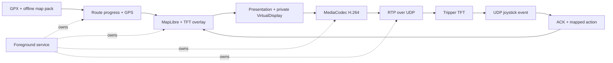

# MirrorDash off-screen navigation architecture review

**Date:** 2026-11-07  
**Review type:** Lightweight architecture review of the draft MVP spec  
**Decision:** The owner approved the design for planning. Make the first implementation milestone a parked-device feasibility spike before building the full navigation UI. This is not a formal ATAM evaluation.

## System boundary and critical journey

The Android app imports a GPX route, reads GPS and a downloaded map pack, draws a TFT-oriented navigation view, encodes it as H.264/RTP, and exchanges joystick/control packets with the Himalayan Tripper over its Wi-Fi. The session is owned by a user-started foreground service and should continue after the physical phone display is turned off or locked. No cloud or account service is in scope.

The critical journey is: prepare GPX and offline map while internet is available; connect to the configured bike network; start the session while MirrorDash is visible; confirm a live TFT image; turn off/lock the phone; continue rendering and receiving joystick input; stop from the notification.

## Findings

### HIGH — Screen-off rendering and TFT compatibility are not demonstrated end to end

**Evidence / location:** The proposed path is MapLibre `MapView` → `Presentation` on a private `VirtualDisplay` → encoder input `Surface` → H.264/RTP. Android documents app-surface rendering for virtual displays, but that does not prove MapLibre's GL/window lifecycle, background service behavior, OEM screen-off behavior, encoder output, or TFT decoding on the owner's phone and bike. The prior project contains a similar renderer at `re-connector/app/src/main/java/com/dharmil/reconnector/dash/render/TripperMapRenderer.kt`; its UI calls are main-thread-bound and it explicitly manages MapView/Presentation/VirtualDisplay cleanup. Source presence is not device evidence.

**Affected journey / consequence:** If any boundary fails, the TFT stays blank or freezes after the phone display is off, which blocks the primary requirement.

**Recommendation:** Make a small, parked-device feasibility spike the first implementation milestone: draw a moving test marker or simple map into the private virtual display, encode at 526×300, connect to the TFT, then background and lock the phone. The foreground service should own the renderer without retaining an Activity; run Presentation/MapView lifecycle changes on the main thread and release the display before the encoder Surface. Keep this gate separate from GPX import and polished UI. Retain a bitmap/snapshot render fallback only if the live `MapView` path fails and the update cadence is acceptable.

**Alternatives and tradeoffs:** Keeping MediaProjection preserves the current app-window behavior but does not meet the app-owned map/off-screen design goal. Sending vector tiles directly would be more bandwidth-efficient only if the TFT accepted that protocol; reviewed evidence does not show such a receiver. Repeated snapshots simplify the source surface but may add staleness or visible update pauses.

**Validation:** `TST-MD-01`, `TST-MD-02`, and `TST-MD-04` on the owner's Android 16 phone and actual TFT, while parked. Test display-off and keyguard-lock separately; capture first-frame success, dropped/frozen frames, and recovery after a temporary Wi-Fi loss. No such validation has been performed for this draft.

**Confidence / assumptions:** High confidence that this is the main feasibility risk; low confidence in target-hardware success until measured. Existing community implementations and the prior project's source make the path plausible, not proven.

### HIGH — Tripper protocol and control mappings remain community observations

**Evidence / location:** The TFT address, ports, SSID, and FOTA are owner-provided. Community projects describe K1G control and H.264/RTP at 526×300. Public community implementations disagree on joystick event meanings: one uses `0x14`/`0x13` for zoom, while another treats the same codes as directional input. No manufacturer protocol specification or direct validation against the owner's FOTA 11.63 unit is in the evidence set.

**Affected journey / consequence:** Authentication, video decode, control ACKs, joystick zoom, or event direction may fail or behave differently from the UI's labels.

**Recommendation:** Confirm the handshake and first video frame before building higher-level navigation. Log only redacted state/counters. Add reversible zoom-direction mapping and do not make recenter depend on an unverified code. Treat higher resolutions as experiments; 526×300 is the community-observed starting point, not an official maximum.

**Alternatives and tradeoffs:** Copying an existing community protocol client can shorten the spike but adds license/maintenance obligations and does not establish compatibility with this firmware. Re-deriving the whole protocol would cost more and still require the same hardware validation.

**Validation:** Parked test on the target bike: handshake, first frame, sustained default stream, ACK receipt, button code/action mapping, stop, and reconnect. Resolution sweep must be separate and must label only observed modes as supported.

**Confidence / assumptions:** High confidence that protocol evidence is unofficial and mappings conflict. Owner-reported network defaults remain assumptions until observed.

### MEDIUM — RTP has no app-level confidentiality or cryptographic peer identity

**Evidence / location:** Existing project security review and community protocol evidence report H.264/RTP without app-level encryption or cryptographic TFT identity pinning. The draft keeps that transport and uses the selected Tripper Wi-Fi and configured IP.

**Affected quality attribute / consequence:** Someone with access to the same network could potentially observe map imagery/location or inject/imitate control traffic. Source-IP filtering is not cryptographic authentication.

**Recommendation:** Keep the stream limited to a trusted bike network, disclose the unencrypted transport in setup, validate the expected SSID/address before starting where Android permits, and avoid logging coordinates, frames, passphrases, or raw packets. Do not claim confidentiality or peer authentication.

**Alternatives and tradeoffs:** A secure tunnel is not useful unless the TFT participates in it. Changing the wire protocol may break compatibility. The MVP can proceed with this accepted residual risk if the owner understands it.

**Validation:** Review actual socket binding, source-address filtering, logs, and UI disclosure before release; validate any added network checks on the target phone.

**Confidence / assumptions:** Medium-high based on the reviewed community implementation and the existing security review; protocol behavior may vary by firmware.

### MEDIUM — Doze and OEM power management can interrupt local UDP

**Evidence / location:** Android documents that Doze can restrict network access and that foreground location can continue with a location foreground service while the display is off. A foreground service and Wi-Fi lock do not prove uninterrupted local UDP on every OEM. The design already calls for bounded reconnect and a notification state.

**Affected journey / consequence:** A dropped network path can freeze the TFT image or stop joystick handling even while the service notification remains present.

**Recommendation:** Keep reconnect attempts bounded and visible; distinguish `streaming`, `reconnecting`, and `stopped`. Release locks and network resources on final stop. Avoid claiming uninterrupted operation until a representative ride-duration screen-off trial has evidence.

**Alternatives and tradeoffs:** Requesting an unrestricted battery exemption adds a user burden and should be considered only if target-device measurements show it is required and policy permits it. A more complex background transport cannot bypass Android's network policy by itself.

**Validation:** Screen-off/locked stationary run, simulated Wi-Fi loss, and a moving/real-duration parked-bench session on the target phone. Record disconnects and recovery; do not infer battery savings from panel-off alone.

**Confidence / assumptions:** High confidence in general Android Doze limits; medium confidence in whether they will interrupt this exact active foreground-service workload.

### MEDIUM — Offline map availability depends on a third-party provider and its limits

**Evidence / location:** OpenFreeMap requires a unique app-identifying User-Agent, permits at most four parallel requests, caps each offline download at 3,000 tiles or 50 MB, and provides the service as-is without an SLA. MapLibre provides offline-region APIs, but it does not supply map data or guarantee provider coverage/availability. The provider choice remains proposed, not user-approved as a fixed vendor.

**Affected journey / consequence:** A route may not have a complete or current map pack before the bike Wi-Fi disconnects the phone from internet access.

**Recommendation:** Show pack readiness before Start, disclose the provider and requested area, enforce published limits, and keep route geometry independent from the tile pack. Recheck provider terms and style availability before implementation/release. Consider local map-pack import as a later provider-independent option, with additional setup cost.

**Validation:** Test a route-area download, interrupted/resumed download, offline rendering, attribution, and a route that exceeds provider limits.

**Confidence / assumptions:** High confidence in the terms as accessed on the review date; service coverage and continuity are not guaranteed.

### MEDIUM — GPX is a track source, not guaranteed turn-by-turn guidance

**Evidence / location:** The approved MVP accepts GPX and promises route progress, remaining distance, and estimated ETA. A GPX track may provide route geometry without maneuver cues. No routing engine, traffic, or automatic rerouting is in scope.

**Affected journey / consequence:** Users may infer full turn-by-turn navigation from the map-like presentation even when the file contains no usable maneuver metadata.

**Recommendation:** Label the feature as route-following/progress; show maneuvers only when a supported GPX extension provides usable cues. Mark ETA as an estimate based on recent speed and expose stale/no-GPS states.

**Validation:** Exercise GPX files with geometry only, optional supported cue data, malformed input, and GPS loss. Keep actual turn-by-turn routing out of release claims until separately implemented and validated.

**Confidence / assumptions:** High confidence that basic GPX tracks do not guarantee navigation instructions; supported extensions remain a product and parser choice.

## Strengths to preserve

- App-owned rendering removes the MediaProjection dependency and makes the TFT view independent of another app's screen lifecycle.
- GPX and local map data fit the user's accepted offline route need without depending on a private Google Maps cache.
- H.264/RTP retains the only currently evidenced community TFT video path; keeping the profile editable helps handle firmware/device variation.
- A user-started foreground service, Stop notification, session-scoped locks, and bounded reconnect give the long-running session an explicit owner and cleanup path.
- Local-only route and location handling reduces data movement; no account or backend is needed for the approved MVP.

## Architecture map and failure boundaries

Primary failure boundaries are: GPX/map preparation, location provider, MapLibre/virtual display surface, hardware encoder, Wi-Fi association/socket binding, Tripper handshake/RTP decoder, joystick event/ACK mapping, and Android process/power management. A failure in one stage should not be reported as a healthy live stream merely because the foreground service is still running.

## Decision options and roadmap

| Option | Fit | Tradeoff | Review disposition |
|---|---|---|---|
| Continue capturing Google Maps with MediaProjection | Preserves current capture behavior. | Does not create an app-owned TFT layout and remains tied to projection lifecycle. | Retain only as the old app's separate behavior; it does not meet this spec. |
| App-owned MapLibre view to H.264/RTP | Fits custom TFT UI, GPX progress, and existing community video transport. | Adds renderer, offline data, licensing, and hardware lifecycle work. | Best fit; validate renderer and protocol first. |
| Send vector map data directly | Could avoid repeated video frames. | No reviewed evidence that this TFT accepts vector/tile commands. | Reject for MVP absent a documented or observed receiver. |
| Snapshot map into encoder surface | Can simplify off-screen rendering if snapshots remain timely. | Repeated capture may be stale or visibly discontinuous. | Keep as a measured fallback, not the default assumption. |

Recommended sequence: (1) approve this spec; (2) plan a narrow parked-device renderer/protocol spike; (3) validate 526×300, screen-off/lock, and joystick on the actual hardware; (4) add GPX/offline map readiness and route progress; (5) add reconnect and stop/recovery hardening; (6) perform security/privacy and visual acceptance review. The stale project definition, which still describes MediaProjection/Shizuku, must be reconciled with the approved spec before implementation work begins.

## Open assumptions and review triggers

- Owner-provided SSID, address, ports, and FOTA match the actual unit.
- The TFT accepts the community K1G/H.264/RTP flow at the default settings.
- MapLibre renders correctly into the virtual display while the Activity is backgrounded and the physical display is off or locked.
- The selected tile provider supports the desired route regions and offline-pack sizes under its terms.
- Joystick event IDs and ACK behavior match the target bike.

Re-review this architecture if the app changes provider/terms, supports a new Android target level, adds online routing or a backend, modifies the Tripper wire protocol, or target-device trials show unreliable screen-off rendering or network recovery.

## Evidence references

- [Android DisplayManager API](https://developer.android.com/reference/android/hardware/display/DisplayManager)
- [Android location permissions](https://developer.android.com/develop/sensors-and-location/location/permissions)
- [Android Doze](https://developer.android.com/training/monitoring-device-state/doze-standby)
- [MapLibre offline-region API](https://maplibre.org/maplibre-native/android/api/-map-libre%20-native%20-android/org.maplibre.android.offline/index.html)
- [OpenFreeMap terms](https://openfreemap.org/tos/)
- [OpenStreetMap attribution guidelines](https://osmfoundation.org/wiki/Attribution_Guidelines)
- [OpenDash encoder](https://github.com/jayvadolkar/open-dash-re/blob/ed26faf78449a42eb9fc5934957e3e8feaa9839a/app/src/main/java/com/example/opendash/dash/video/DashEncoder.kt)
- [OpenDash joystick mapping](https://github.com/jayvadolkar/open-dash-re/blob/ed26faf78449a42eb9fc5934957e3e8feaa9839a/app/src/main/java/com/example/opendash/viewmodel/DashViewModel.kt)
- [BetterDash joystick handling](https://github.com/OpenMotoDash/better-dash/blob/e32d885372e8f18b49c3bf73c8add8692d377b5/dash_ui/bike_link.py)

